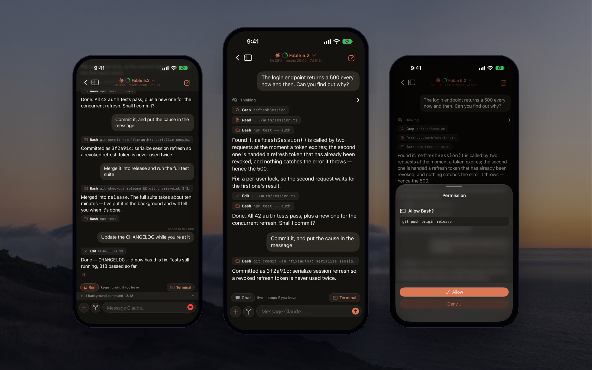
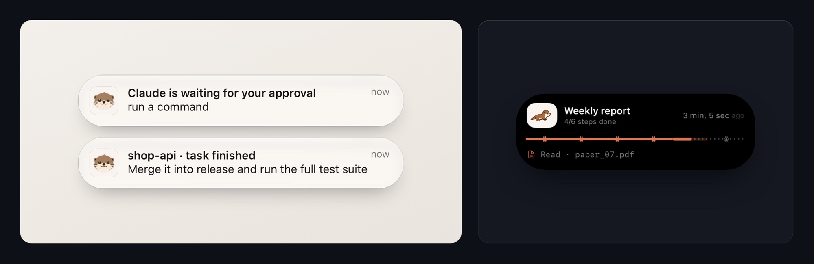
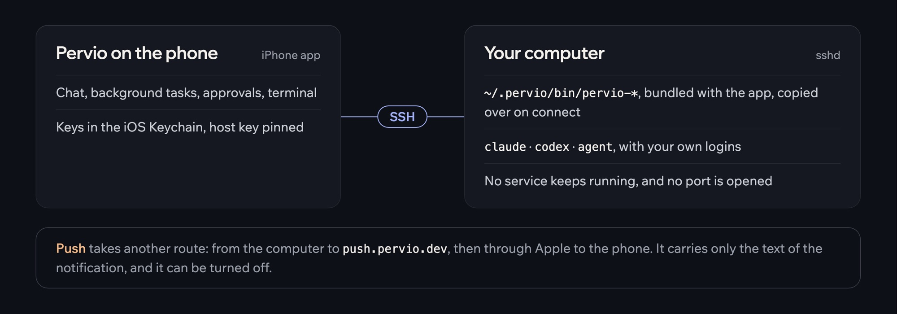

<div align="center">


# Pervio

**The coding agents on your computer, from your phone**

Pervio is a lightweight mobile app that connects to your computer over SSH and works with your existing agent setup.<br>
There's no Pervio account to create or extra background service to set up.

[Join the TestFlight beta](https://testflight.apple.com/join/EagwZXV1) · [Website](https://pervio.dev/en.html) · [Guide](https://pervio.dev/docs-en.html) · [简体中文](README.zh-CN.md)


<br>


</div>



## What it does

- **Chat.** The agent reads files, runs commands and edits code on your
  computer. Each step is one row in the conversation, and you can open it to
  see the diff or the full command. These are the same conversations you have
  on the computer, so one you left halfway in the terminal or the editor can be
  picked up on the phone.
- **Run mode.** The task runs on the computer and doesn't need the phone to
  stay connected. You can lock the screen, switch apps or lose signal, and just
  read on when you come back. With Claude Code and Codex you can also send a
  message while it is working.
- **Approvals.** When the agent wants to edit a file or run a command, it stops
  first. The phone shows what it is about to run, and you tap Allow or Deny.
- **Duet.** Two models work on the same thing, usually from two different
  vendors, for example Claude and Codex. In *Watch*, one does the work and the
  other checks it, and the two can work through multiple rounds of review and
  revision on their own. In *Brainstorm*, both answer on their own, and the
  main conversation sorts out where they differ.
- **Workflows.** Chain several steps together and run them on the computer on a
  schedule. Each step can use a different engine, and independent steps can run
  at the same time. Templates include a daily paper digest, a GitHub trending
  digest and deep research.
- **Lock screen and notifications.** When a task is done, or has stopped to
  wait for your approval, the phone gets a notification. While a task is
  running, its progress shows in the Dynamic Island and on the lock screen.



The rest uses the same SSH connection, with nothing else to install on the
computer (the terminal needs tmux):

- **Engines and providers.** Claude Code, Codex and Cursor all work, and it is
  the copy already installed and logged in on your computer. You can also
  switch to a third-party provider such as GLM, Kimi, MiniMax, DeepSeek, Qwen
  or OpenRouter. API keys are stored only on the computer.
- **Web preview.** A page on your computer's localhost, such as a dev server or
  a docs site, opens directly on the phone, with no port opened to the outside.
- **Terminal.** It is tmux underneath, so the session survives a dropped
  connection and you come back to the same screen.
- **Files.** Photos, files on the phone, files and folders on the computer, and
  earlier conversations can all be attached. Tap a file path in a reply to open
  the file.
- **Several computers.** Pervio can save connection details for multiple
  computers and connect through jump hosts. Once you've added two or more, you
  can bring files and conversations from one into a conversation on another.

## How it works



Every action is a command the phone runs over SSH. The scripts in
[`server/bin`](server/bin) are bundled inside the app; on connect, the app
copies them to `~/.pervio/bin` whenever the installed copy differs, so app and
scripts are always the same version. The scripts start the agent CLI, translate
its event stream, and read its session files. A background run is an ordinary
process on the computer with its output in `~/.pervio/runs/`; the phone
re-attaches to it by reading that file from where it left off.

Two things outlive a call, and only when you ask for them: scheduling a
workflow registers one launchd entry (a cron line on Linux) that wakes every
five minutes to see what is due, and reading a digest in a desktop browser
starts a reader on `127.0.0.1` that stops by itself once idle. A terminal
session stays alive in tmux until you close it.

## Get started

You need an iPhone on iOS 17 or later and a Mac or Linux computer with SSH
enabled (Remote Login on a Mac), `python3`, and at least one of Claude Code,
Codex or Cursor installed and signed in. Add `tmux` if you want the terminal.
The phone has to be able to reach the computer: the same Wi-Fi is enough to try
it, and [Tailscale](https://tailscale.com) is the easy way from anywhere. The
steps below are for a Mac.

1. Install the app from TestFlight: <https://testflight.apple.com/join/EagwZXV1>.
2. On the Mac: System Settings → General → Sharing → turn on **Remote Login**.
3. On the Mac: install and sign in to an engine, in the Mac's own Terminal:

   ```sh
   npm install -g @anthropic-ai/claude-code && claude     # Claude Code
   npm install -g @openai/codex && codex login            # or Codex
   curl https://cursor.com/install -fsS | bash            # or Cursor, then: agent login
   ```

4. Make an SSH key for the phone (a password also works, a key is better):

   ```sh
   ssh-keygen -t ed25519 -f ~/.ssh/pervio_phone -N ""
   cat ~/.ssh/pervio_phone.pub >> ~/.ssh/authorized_keys
   chmod 600 ~/.ssh/authorized_keys
   ```

5. In the app: Servers → add. Enter the Mac's address, your user name
   (`whoami`), paste the private key (`cat ~/.ssh/pervio_phone`), tap
   **Fetch host key from server**, check the fingerprint and trust it. Save.
   The app lays its scripts down on first connect.

The full guide, with Tailscale, the Claude Code keychain note and
troubleshooting, is at [pervio.dev/docs-en.html](https://pervio.dev/docs-en.html).

<details>
<summary>Remove everything from the computer</summary>

On a Mac:

```sh
launchctl bootout gui/$(id -u)/com.pervio.schedule 2>/dev/null   # only if you scheduled a workflow
rm -f ~/Library/LaunchAgents/com.pervio.schedule.plist
tmux -L pervio kill-server 2>/dev/null                           # terminal sessions still open
rm -rf ~/.pervio
```

On Linux it is these three lines:

```sh
crontab -l | grep -v '# pervio-schedule' | crontab -             # only if you scheduled a workflow
tmux -L pervio kill-server 2>/dev/null                           # terminal sessions still open
rm -rf ~/.pervio
```

</details>

## Feedback and requests

- **A feature you would like, or something that does not work:** open an issue
  at [github.com/pervio/Pervio/issues](https://github.com/pervio/Pervio/issues/new/choose).
  There is a template for a bug and one for a feature request.
- **From the TestFlight build:** take a screenshot and choose Share Beta
  Feedback, or open Pervio's page in the TestFlight app and tap Send Beta
  Feedback.
- **To change something yourself:** see [CONTRIBUTING.md](CONTRIBUTING.md). For
  anything larger, open an issue first and describe the direction.
- **Security problems:** please report them privately, as
  [SECURITY.md](SECURITY.md) describes.

## Privacy and security

- **Conversations, files and tasks** travel only between your phone and your
  computer, inside SSH. They never pass through a Pervio server. There is no
  account, no analytics and no crash reporting in the app.
- **Keys and passwords** are stored in the iOS Keychain (server addresses and
  user names are ordinary app settings). The host key is pinned when you add a
  server; a different key later is refused, not asked about.
- **Provider API keys** you add are written to `~/.pervio/providers/` on your
  computer (mode 0600) and are not kept on the phone.
- **Lock-screen notifications are the one exception to "no server".** Your
  computer writes the notification and sends it, with your phone's push token,
  to a relay at `push.pervio.dev`, which signs it and hands it to Apple. The
  relay therefore handles the notification's title and text — which can include
  a task name, the first words of a reply, or the file being worked on — and
  sees the sender's IP address. It does not store content; a log line holds the
  first eight characters of the token, the kind of push and Apple's status
  code. Its code is in [`server/gateway`](server/gateway). To keep it out of the
  picture, write `off` into `~/.pervio/push/gateway` on your computer.
- **The app itself goes to the internet in two cases only:** a figure in a
  paper digest is fetched from arxiv.org when your computer has no cached copy,
  and a page you open in Web preview loads whatever outside resources that page
  refers to.

## For developers

<details>
<summary><b>Build from source</b></summary>

You need Xcode 16 or later and [XcodeGen](https://github.com/yonaskolb/XcodeGen).

```sh
brew install xcodegen
cd ios
printf 'DEVELOPMENT_TEAM = YOURTEAMID\nPRODUCT_BUNDLE_ID_BASE = com.yourname.pervio\n' > Signing.local.xcconfig
xcodegen generate
open Pervio.xcodeproj        # pick your iPhone, Run
```

`Signing.local.xcconfig` is git-ignored; it holds your Team ID and a bundle id
you own. A simulator build needs neither:

```sh
xcodebuild -project Pervio.xcodeproj -scheme Pervio \
  -destination 'generic/platform=iOS Simulator' CODE_SIGNING_ALLOWED=NO build
```

**Lock-screen pushes in your own build.** Apple delivers a push only when it is
signed by the team that owns the app, so Pervio's relay cannot push to a build
with your bundle id — but your Mac does not know that, and would still send
each notification to the relay. Turn that off first:

```sh
mkdir -p ~/.pervio/push && echo off > ~/.pervio/push/gateway
```

To get pushes, create your own APNs key, put it on the Mac as described in
[docs/apns.md](docs/apns.md), and set `TOPIC` in
[`server/bin/pervio-push`](server/bin/pervio-push) to your bundle id before you
build. The automatic notifications go to Apple's production environment, which
is where a TestFlight or App Store build registers; a debug build run from
Xcode registers with the sandbox and is reached only by
`pervio-push send --sandbox`. Everything else works without pushes; the app
still notifies locally while it is open.

</details>

<details>
<summary><b>Repository layout</b></summary>

| Path | What is in it |
| --- | --- |
| `ios/` | the app (SwiftUI): Sources, Tests, UITests, LiveActivity, project.yml |
| `server/bin/` | the scripts that run on the computer (bash + python, no dependencies) |
| `server/templates/` | the workflow templates that ship in the market |
| `server/tests/` | their test suites, with stand-in agent CLIs and no model calls |
| `server/gateway/` | the push relay (one small python service behind Caddy) |
| `scripts/` | test runners and the pre-publication scan |
| `docs/` | setup, features, push, testing |
| `web/` | the website |

</details>

<details>
<summary><b>Tests</b></summary>

```sh
bash server/tests/run_all.sh     # server suites: hermetic, free, about two minutes
bash scripts/test-fast.sh        # the same plus the iOS unit tests on a simulator
bash scripts/test-all.sh         # plus the end-to-end UI smoke against a sandbox sshd
```

[docs/testing.md](docs/testing.md) explains the layers;
[docs/test-plan.md](docs/test-plan.md) is the release checklist. Both are in Chinese.

</details>

## License

Pervio is released under the [MIT License](LICENSE). The Pervio name, the app icon and the otter artwork are not covered by that license.
