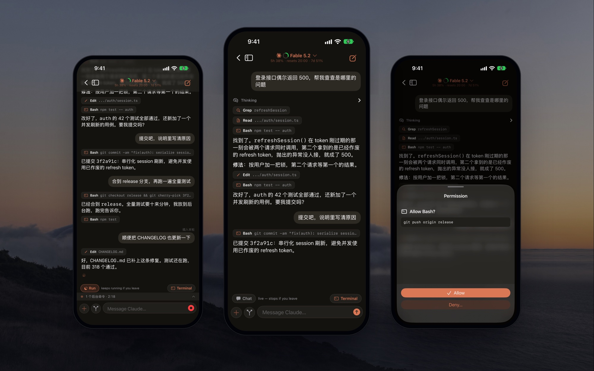
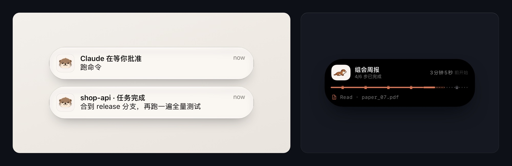
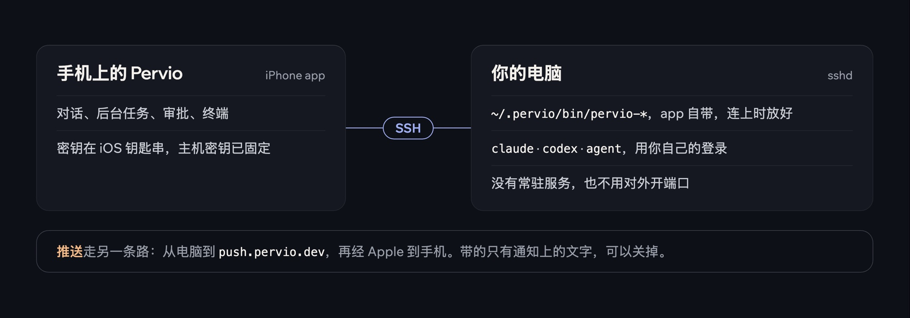

<div align="center">


# Pervio

**用手机指挥你自己电脑上的编程 agent**

Pervio 是一个轻量级的手机 app，通过 SSH 连接你的电脑，直接使用电脑上已经安装并登录的编程 agent。<br>
无需注册 Pervio 账号，也不用在电脑上另装常驻服务。

[加入 TestFlight 公测](https://testflight.apple.com/join/EagwZXV1) · [官网](https://pervio.dev) · [使用文档](https://pervio.dev/docs.html) · [English](README.md)


<br>


</div>



## 能做什么

- **对话。** agent 在电脑上读取文件、执行命令或修改代码时，对应的操作记录会逐条显示在对话中。点开记录，就能查看完整命令或代码差异（diff）。手机和电脑共用同一份对话记录，在终端或编辑器里进行到一半的对话，也可以在手机上继续。
- **Run 模式。** 任务在电脑上运行，不需要手机始终保持连接。即使手机锁屏、切换到其他 app 或暂时断网，任务仍可继续，重新连接后就能查看进度。使用 Claude Code 或 Codex 时，还可以在任务运行过程中继续发送消息。
- **审批。** agent 在修改文件或执行命令前会暂停，等待你在手机上查看具体操作，并选择允许或拒绝。
- **双开。** 你可以让两个模型共同处理一项任务，通常会选择 Claude 和 Codex 这类来自不同厂商的模型。在「监督」模式下，一个模型负责执行，另一个负责检查，双方可自主进行多轮检查与修改。在「头脑风暴」模式下，两个模型分别给出回答，再由主对话整理分歧和结论。
- **工作流。** 你可以将多个步骤组成工作流，定时在电脑上运行，并在完成后获得可直接阅读的结果。每个步骤可以使用不同的引擎，没有依赖关系的步骤可以同时运行。Pervio 自带论文晨报、GitHub 热点日报和深度调研等模板。
- **锁屏和通知。** 任务完成或等待你批准操作时，手机会收到通知；运行中的任务进度则会显示在灵动岛和锁屏上。



其他功能都使用同一条 SSH 连接，电脑上无需额外安装软件，只有终端功能需要 tmux：

- **引擎和供应商。** Pervio 使用你在电脑上已安装并登录的 Claude Code、Codex 或 Cursor，也支持切换到智谱 GLM、Kimi、MiniMax、DeepSeek、通义千问、OpenRouter 等第三方供应商，API key 只保存在电脑上。
- **网页预览。** 你可以通过 SSH 在手机上打开电脑 localhost 上的网页，例如开发服务器和文档站，无需对外开放网页端口。
- **终端。** 终端基于 tmux，因此断线后会话仍会保留，重新连接即可回到之前的界面。
- **文件。** 你可以将照片、手机上的文件、电脑上的文件和目录，以及以往的对话添加到当前对话中。回复中出现的文件路径也可以直接点开查看。
- **多台电脑。** Pervio 可以保存多台电脑的连接信息，也支持经跳板机连接。添加两台以上电脑后，你可以把一台电脑上的文件和对话带到另一台的对话中。

## 怎么实现的



手机上的每个动作，都是经 SSH 在电脑上执行的一条命令。[`server/bin`](server/bin) 里的脚本打包在 app 里；连接时只要电脑上的那份和 app 带的不一样，app 就重新放到 `~/.pervio/bin`，所以 app 和脚本永远是同一个版本。脚本负责启动 agent 命令行、翻译它的事件流、读它的会话文件。后台任务就是电脑上一个普通进程，输出写在 `~/.pervio/runs/`；手机重新连上后，从上次读到的位置接着读这个文件。

有两样东西会在一次调用之后留下来，而且都是你要了才有：设了定时的工作流，会登记一条 launchd 任务（Linux 上是一行 cron），每五分钟醒一次看有没有到点的；在电脑浏览器里读一期成品时，会在 `127.0.0.1` 上起一个阅读页，闲置后自己退出。终端会话由 tmux 保活，直到你关掉它。

## 开始用

需要一部 iOS 17 及以上的 iPhone，和一台 Mac 或 Linux 电脑：开启 SSH（Mac 上叫「远程登录」），有 `python3`，Claude Code、Codex、Cursor 至少安装并登录一个，要用终端再装 `tmux`。手机要能连到电脑：同一个 Wi-Fi 就能试，出门在外推荐 [Tailscale](https://tailscale.com)。下面的步骤按 Mac 写。

1. 从 TestFlight 装 app：<https://testflight.apple.com/join/EagwZXV1>。
2. Mac 上：系统设置 → 通用 → 共享 → 打开**远程登录**。
3. Mac 上：在 Mac 自己的「终端」里装好并登录一个引擎：

   ```sh
   npm install -g @anthropic-ai/claude-code && claude     # Claude Code
   npm install -g @openai/codex && codex login            # 或 Codex
   curl https://cursor.com/install -fsS | bash            # 或 Cursor,然后 agent login
   ```

4. 给手机生成一把 SSH 密钥（也可以用密码，密钥更安全）：

   ```sh
   ssh-keygen -t ed25519 -f ~/.ssh/pervio_phone -N ""
   cat ~/.ssh/pervio_phone.pub >> ~/.ssh/authorized_keys
   chmod 600 ~/.ssh/authorized_keys
   ```

5. app 里：服务器 → 添加。填 Mac 的地址、用户名（`whoami` 的输出），粘贴私钥（`cat ~/.ssh/pervio_phone`），点 **Fetch host key from server**，核对指纹后信任，保存。第一次连接时 app 会自动把脚本放到 Mac 上。

完整步骤（Tailscale、Claude Code 钥匙串的说明、排错）见[使用文档](https://pervio.dev/docs.html)。

<details>
<summary>从电脑上彻底卸掉</summary>

Mac 上：

```sh
launchctl bootout gui/$(id -u)/com.pervio.schedule 2>/dev/null   # 设过定时工作流才需要
rm -f ~/Library/LaunchAgents/com.pervio.schedule.plist
tmux -L pervio kill-server 2>/dev/null                           # 还开着的终端会话
rm -rf ~/.pervio
```

Linux 上是这三行：

```sh
crontab -l | grep -v '# pervio-schedule' | crontab -             # 设过定时工作流才需要
tmux -L pervio kill-server 2>/dev/null                           # 还开着的终端会话
rm -rf ~/.pervio
```

</details>

## 反馈和需求

- **想要新功能，或者遇到了问题：**到 [GitHub Issues](https://github.com/pervio/Pervio/issues/new/choose) 提一条，有「问题反馈」和「功能需求」两个模板。
- **用的是 TestFlight 版：**截一张屏，选择「共享 Beta 版反馈」，或者在 TestFlight 里打开 Pervio，点「发送 Beta 版反馈」。
- **想自己动手改：**先看 [CONTRIBUTING.md](CONTRIBUTING.md)。改动比较大的，先开一个 issue 说明方向。
- **安全问题：**请不要公开提，按 [SECURITY.md](SECURITY.md) 里写的方式私下报告。

## 隐私与安全

- **对话、文件、任务**只在你的手机和你的电脑之间、在 SSH 里传输，不经过 Pervio 的任何服务器。app 里没有账号、没有统计、没有崩溃上报。
- **密钥和密码**存在 iOS 钥匙串（服务器地址、用户名是普通的 app 设置）。添加服务器时固定主机密钥，以后密钥对不上就直接拒连，不会问你要不要继续。
- **供应商 API key** 写在你电脑的 `~/.pervio/providers/`（权限 0600），手机不保存。
- **锁屏推送是「没有服务器」的唯一例外。** 你的电脑把通知写好，连同手机的推送 token 发给 `push.pervio.dev` 上的中继，中继签名后转给 Apple。所以这台中继会经手通知的标题和正文——里面可能有任务名、回复开头的几十个字、正在处理的文件名——也看得到发送方的 IP。它不保存内容；日志每条只有 token 的前 8 位、推送类型和 Apple 返回的状态码。代码在 [`server/gateway`](server/gateway)。不想经过它：在电脑上把 `off` 写进 `~/.pervio/push/gateway`。
- **app 自己只在两种情况下直接上网：** 论文晨报里的配图，电脑上没有缓存时由手机直接向 arxiv.org 取；网页预览里打开的页面如果引用了外部资源，由那个页面自己加载。

## 给开发者

<details>
<summary><b>从源码构建</b></summary>

需要 Xcode 16 及以上和 [XcodeGen](https://github.com/yonaskolb/XcodeGen)。

```sh
brew install xcodegen
cd ios
printf 'DEVELOPMENT_TEAM = 你的TeamID\nPRODUCT_BUNDLE_ID_BASE = com.yourname.pervio\n' > Signing.local.xcconfig
xcodegen generate
open Pervio.xcodeproj        # 选你的 iPhone,运行
```

`Signing.local.xcconfig` 不入库，里面是你的 Team ID 和一个你自己的 bundle id。只编模拟器版两样都不需要：

```sh
xcodebuild -project Pervio.xcodeproj -scheme Pervio \
  -destination 'generic/platform=iOS Simulator' CODE_SIGNING_ALLOWED=NO build
```

**自己编译的版本和锁屏推送。** 苹果只投递由 app 所属团队签名的推送，所以 Pervio 的中继推不到你 bundle id 下的版本——但你的电脑并不知道这一点，仍会把每条通知发给中继。先把它关掉：

```sh
mkdir -p ~/.pervio/push && echo off > ~/.pervio/push/gateway
```

想要推送，就自己建一把 APNs 密钥，按 [docs/apns.md](docs/apns.md) 放到 Mac 上，并在编译前把 [`server/bin/pervio-push`](server/bin/pervio-push) 里的 `TOPIC` 改成你的 bundle id。自动发出的通知走苹果的正式环境，对应 TestFlight / App Store 的版本；从 Xcode 直接装到手机的调试版登记的是沙盒环境，只有 `pervio-push send --sandbox` 能推到。不配推送不影响其他功能，app 开着时仍有本地提醒。

</details>

<details>
<summary><b>仓库结构</b></summary>

| 路径 | 里面是什么 |
| --- | --- |
| `ios/` | app（SwiftUI）：Sources、Tests、UITests、LiveActivity、project.yml |
| `server/bin/` | 跑在电脑上的脚本（bash + python，无依赖） |
| `server/templates/` | 市场里自带的工作流模板 |
| `server/tests/` | 脚本的测试套件，用假的 agent 命令行，不调模型、不花钱 |
| `server/gateway/` | 推送中继（Caddy 后面一个很小的 python 服务） |
| `scripts/` | 测试入口和发布前的隐私扫描 |
| `docs/` | 安装、功能、推送、测试 |
| `web/` | 网站 |

</details>

<details>
<summary><b>测试</b></summary>

```sh
bash server/tests/run_all.sh     # 服务端套件:自包含、免费,约两分钟
bash scripts/test-fast.sh        # 再加模拟器上的 iOS 单测
bash scripts/test-all.sh         # 再加对着沙箱 sshd 的端到端 UI 冒烟
```

各层怎么分工见 [docs/testing.md](docs/testing.md)；发版关卡见 [docs/test-plan.md](docs/test-plan.md)。

</details>

## 许可

本项目采用 [MIT 协议](LICENSE)。Pervio 的名称、图标和水獭形象不在授权范围内。
