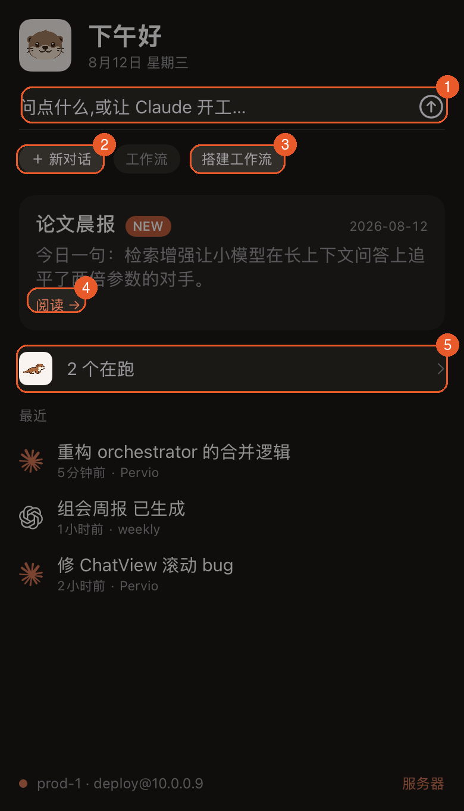
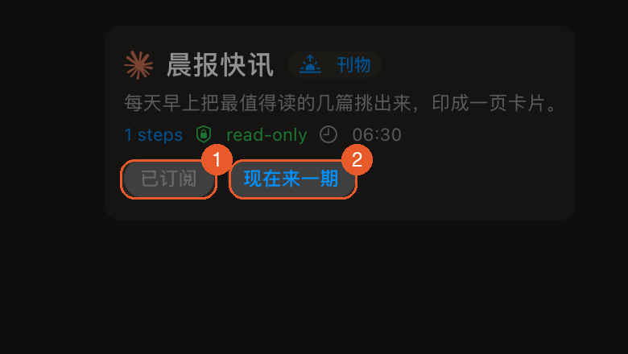
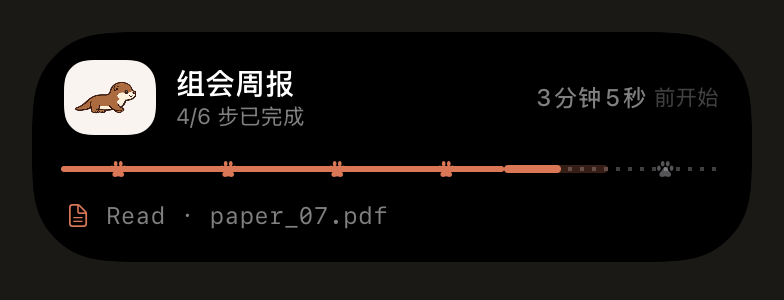
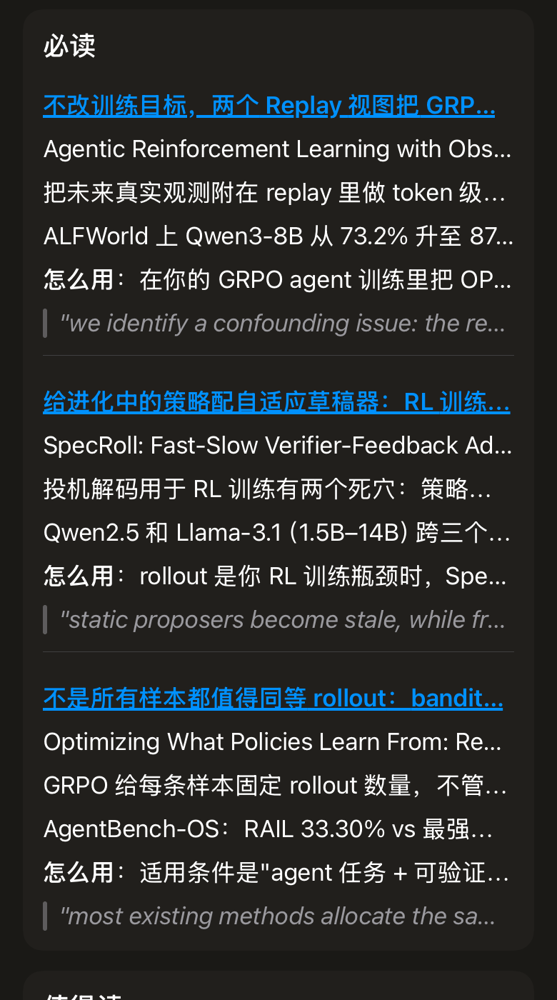
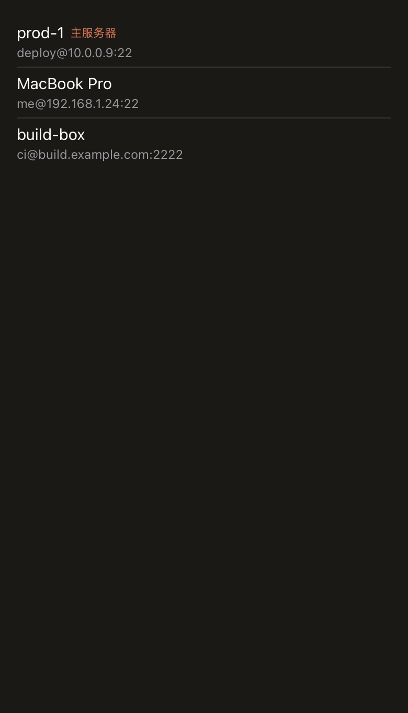
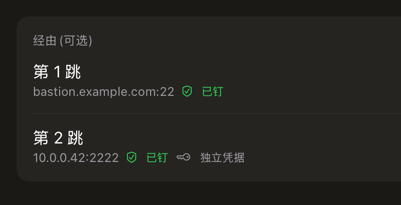
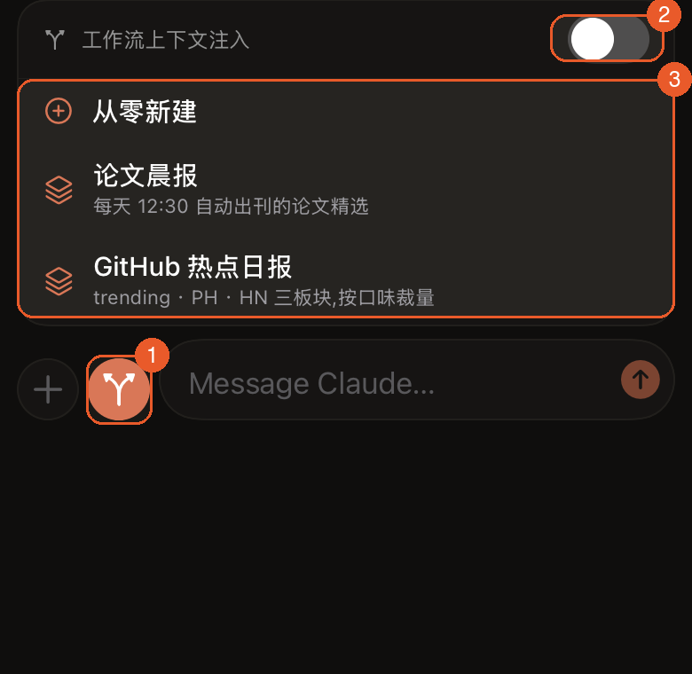

# Pervio 功能一览(图文版)

手机指挥你自己的 Mac 跑 AI:聊天是入口,流水线是主力,成品送到锁屏。
对话、文件、任务全程 SSH 直连你的 Mac,不经任何中转服务器(只有锁屏推送那一条通知经 Pervio 的推送中继转给 Apple);Mac 上没有常驻服务,在跑的只有你自己留下的东西(后台任务、终端会话、定时工作流)。

---

## 首页:一屏看全,一步开工

| 圈 | 是什么 | 干什么用 |
|---|---|---|
| ① | 快问输入框 | 打一句话直接派活,回车即开工 |
| ② | 新对话 | 开一段完整对话(带审批、上传、终端的全功能聊天) |
| ③ | 搭建工作流 | 先选"从零新建"或"改现有模板",描述需求,Claude 替你写好模板并自验 |
| ④ | 今日刊物 · 阅读 | 只摆你在用的刊物:出过刊的、或正在订阅的;市场里没碰过的模板不占首页 |
| ⑤ | N 个在跑 | 正在运行的任务,点进去看每一步的实时进度 |

---

## 市场:订阅刊物,一键装能力

刊物书架(晨报、GitHub 热点日报)+ 能力书架(深度调研、代码审计、小综述)。

① **订阅**:只登记、绝不当场偷跑——到你定的时间,服务器自动出刊。
row 上会写清承诺:"首期今天 XX:XX 自动送达"或"下期明天 XX:XX"。

① **已订阅**:灰色表示这份刊物已在册。
② **现在来一期**:不想等到点?点它立刻印一期(也能补上今天错过的那期)。

> 内测须知:两行服务器刊物要等 SSH 连上才浮现,慢几秒是正常的。

---

## 对话里让 Claude 动订阅?先过你这关

这张弹窗只出现在一种场景:**带工作流上下文的对话里,Claude 想替你
新建/修改订阅**(调用 pervio_schedule 工具)时——完整清单先摆给你:
订什么、几点、周几、保留几期,外加一行明白话 **将消耗模型额度**,
你点允许才落地。

在市场里亲手点"订阅"**不会**弹它——你自己的手不需要再审一遍。
改文件、跑命令等其他敏感工具同理:先弹到你面前,锁屏上会有一条提醒。

---

## 跑起来之后:锁屏就能盯进度

灵动岛上的小水獭每走完一步亮一枚脚印;下方滚动显示当前动作
(正在读哪个文件、跑哪条命令)。不用解锁、不用切 app。
改文件、跑危险命令之前,审批提醒先推到锁屏;点开就是允许 / 拒绝,你点了才继续。

---

## 刊物阅读器:分级、评分、投大屏

- 每期按 **必读 / 速读 / 扫过** 分级,先看结论再决定读不读
- **长按任意一篇打分**——你的口味会喂给明天的选题
- 点图放大;往期秒开
- 一键弹到电脑浏览器看大屏版:网页最多存活 **60 分钟**、关页 10 分钟后
  自动熄灭——看报的服务阅后即焚,不留常驻进程

---

## 多服务器与跳板

可以同时管多台 Mac/服务器,每台独立凭据、独立项目目录。

公司内网机器?配跳板(可以串多跳),每一跳都强制**钉死主机密钥**
(已钉 ✅)——不固定指纹就拒绝连接,中间人无处下手。

---

## 对话:⑂ 工作流面板

| 圈 | 是什么 | 干什么用 |
|---|---|---|
| ① | ⑂ 工作流按钮 | 点开/收起这个面板;面板开着(或本对话带工作流上下文)时按钮点亮,再按一下收起 |
| ② | 工作流上下文开关 | 开 = Claude 能直接列出/运行你的工作流、查运行结果;关 = 纯净对话,零注入省 token |
| ③ | 从零新建 / 改现有模板 | 点一行,对应的说明书自动填进输入框——改模板不需要开②,纯对话就能干 |

- **工作目录就是范围**:添加机器时填的目录决定手机上看到什么——对话、搜索、后台任务、新对话选目录都只在它及其子文件夹里(给对话附加文件不受限);`~` 看全部,`~/a` 只看 a;同一台 Mac 可添加多次,每条一个目录各看各的
- **三家引擎**:Claude Code、Codex、Cursor,对话 / 后台跑 / Duet / 工作流步骤都能选;顶栏一个徽章写着引擎 + 模型 · 供应商,点开是现成组合一下切换;
  第三方供应商(GLM、Kimi…)在服务器设置里填一次就写到 Mac,key 不进手机
- **目录不用手敲**:浏览 Mac 的目录树、或敲几个字补全;有历史的项目长按设为默认;对话右上角「新对话」菜单:当前目录新开 / 换个目录新开 / 换目录并带上本段记录;
  首页 New chat 长按先选目录
- **聊天 / Run 两档**:聊天是即问即答;Run 是后台任务,断网锁屏都不中断
- **子 agent 和后台命令**:agent 派出去的子 agent、放到后台的命令,在输入框上方合成一行(几个在跑、跑了多久),点开是列表:每个的类型、用时、token、调了几次工具、正在做什么,结束的带着结论;Claude Code / Codex / Cursor 的子 agent 都算(Cursor 不报 token);Run 模式下的 Claude Code 可以在列表里单独停掉其中一个
- **素材伸手就到**:相册、Files、Mac 上任意路径、历史对话,同一个 ＋ 进上下文
- **真终端**:连 vim 都能用
- **双开(组)**:在一段对话的 ＋ 菜单里「双开…」,给它配一个伙伴(另一家新对话,或已有对话),三种搭法:
  **头脑风暴**——说一句,主和伙伴同时各答各的,两个答案并排;主随后汇总(先列分歧再给结论)进单独的结论框,
  框里「交给主去做」跳进主的单聊;默认大家只读,成员设置里可开。**监督**——主干活,监督者看结果给意见,最多三轮,
  结尾只说 通过 / 继续 / 需要你。**双窗**——两段对话各聊各的,不自动互通,一键让一边点评另一边的回复。
  整轮由 Mac 推进,手机锁屏也照跑;组拼出来的系统消息在对话里折成一行,后台任务列表里一个组一行
- **公式真排版**:模型写的 LaTeX(`\[…\]`、`\(…\)`、`$…$`)照着排成真公式,不改原文;
  `\bigl`、`\operatorname` 这类写法自动桥接,公式里的中文用系统字体混排;排不出的原样显示源码
- **Mac 上的文件一点即看**:回复里以绝对路径链接的图片、PDF、文本(`[四图对照](/Users/…/comparison.png)`)
  点一下就从 Mac 取回、用系统预览打开,能缩放、翻页、分享;超过 25 MB 会直说
- **置顶有户口**:在对话那一行上向右滑置顶,置顶记在 Mac 的名册上——换手机、重装 app 都在;
  置顶期间任何一方都删不掉它(要删先取消置顶),不会再无声消失
- **codex 对话被 VS Code 占着?一键接管**:codex 规定一段对话同时只能有一个客户端在写,
  VS Code 面板开着就攥着锁。手机上发消息被拒时会出现「强制接管」:确认后 Mac 结束那个
  占用进程(只认 codex 进程、绝不碰 app 自己在跑的任务),再自动重发你刚才那句话;历史不丢

---

## 设置

- **中英一开关整套切换**(界面 + 提示词 + 推送),立即生效不用重启
- **存储可见可清**:图片缓存一键清空,超量自动修剪
- **模型菜单自动更新**:对话和工作流里可选的模型清单来自你的 Mac,新模型
  出来后连一次就有,不用等 app 更新;工作流写"档位"(旗舰/均衡/快)则自动跟上

## 安全底线

- 凭据只进 iOS 钥匙串;手机 ↔ Mac 全程加密直连;无账号、无遥测;锁屏推送经 Pervio 的中继转发,中继不记录内容(见 [apns.md](apns.md))
- 敏感操作权限分级、逐一放行;代码开源可审计
- Mac 侧没有常驻服务:没有守护进程,在跑的只有你自己留下的东西(后台任务、终端会话、定时工作流)
